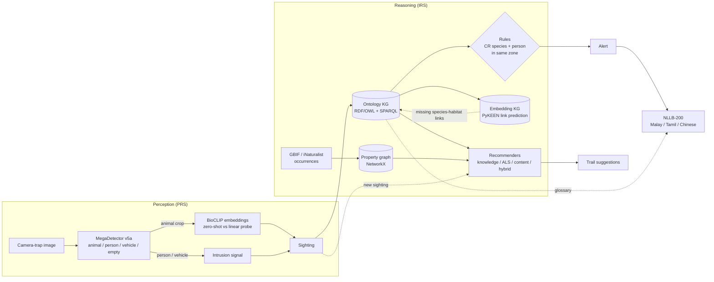

# Wildlife Intelligence System

An AI system for the critically endangered **Malayan tiger** and the wildlife of Singapore and Peninsular Malaysia.
Raw camera-trap images go in. Prioritised, multilingual alerts and visitor trail suggestions come out.

It has two halves that feed each other:

- **Perception (Pattern Recognition Systems):** turns raw signals into *sightings*. This half uses MegaDetector triage, BioCLIP species classification and NLLB-200 translation.
- **Reasoning (Intelligent Reasoning Systems):** turns sightings into *decisions*. This half uses three kinds of knowledge graph, rule-based alerts and recommenders chosen per scenario.

> Portfolio project for my NUS-ISS MTech (AI Systems) application. It is a learning system, not a product.
> Results are reported honestly, failures included. See [STATUS.md](STATUS.md) for what is built and measured so far,
> or the [project page](https://datakeep64.github.io/projects/wildlife-intelligence/) for a plain-English overview.

## Architecture



## Components

| Component | Folder | Course concept | Status |
|---|---|---|---|
| Camera-trap triage + classification | [src/perception/camera_trap](src/perception/camera_trap) | PRS: transfer learning, zero-shot vs supervised probe, honest evaluation | see STATUS |
| Multilingual alerts | [src/perception/translation](src/perception/translation) | PRS: sequence models, MT evaluation (chrF, back-translation) | see STATUS |
| Bioacoustics (optional) | [src/perception/bioacoustics](src/perception/bioacoustics) | PRS: audio classification (BirdNET) | not started |
| Ontology KG + rules | [src/reasoning/kg](src/reasoning/kg) | IRS: knowledge representation, OWL, SPARQL, rule-based reasoning | see STATUS |
| Property graph | src/reasoning/kg | IRS: graph analytics (co-occurrence) | Phase B |
| Embedding KG | src/reasoning/kg | IRS: KG embeddings (TransE vs another model), link prediction | Phase B |
| Recommenders | [src/reasoning/recsys](src/reasoning/recsys) | IRS: knowledge-based vs collaborative vs content-based vs hybrid | see STATUS |
| Integration loop + demo | [src/integration](src/integration) | AI systems: components feeding each other | Phase C |

## Setup

```bash
/opt/homebrew/bin/python3.12 -m venv .venv          # Python 3.12 (3.13+ lacks some wheels)
.venv/bin/pip install -r requirements.txt           # exact versions: requirements.lock.txt

.venv/bin/python data/download_iucn.py              # IUCN status via GBIF        (~10 s)
.venv/bin/python -m src.reasoning.kg.build_seed     # CSV -> RDF facts
.venv/bin/python data/download_lila.py              # 1.4k camera-trap images     (~360 MB)
.venv/bin/python data/download_gbif.py              # SG + Peninsular MY records  (~10 min)

.venv/bin/python -m pytest tests -q                 # smoke + unit tests
```

CPU works for everything. Apple MPS is used automatically when present, and nothing needs a CUDA GPU.
Model weights download on first use: MegaDetector is about 280 MB, BioCLIP about 600 MB and NLLB-600M about 2.4 GB.

## Data sources

All data is public: [LILA BC WCS Camera Traps](https://lila.science/datasets/wcscameratraps), [GBIF](https://www.gbif.org) (including iNaturalist research-grade records), and IUCN Red List categories as mirrored by GBIF.
Data and weights are not committed. See [data/README.md](data/README.md).
