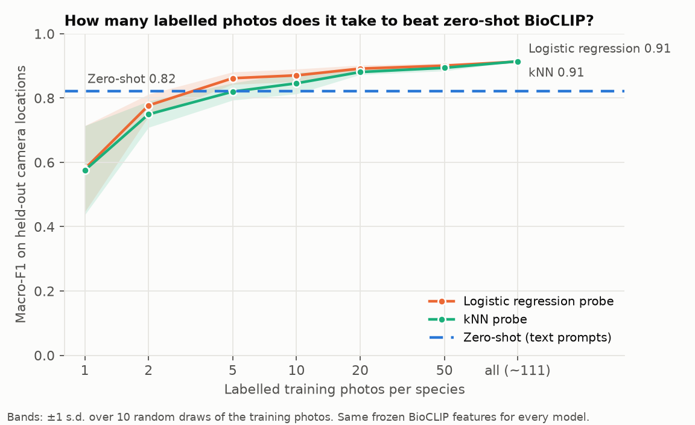
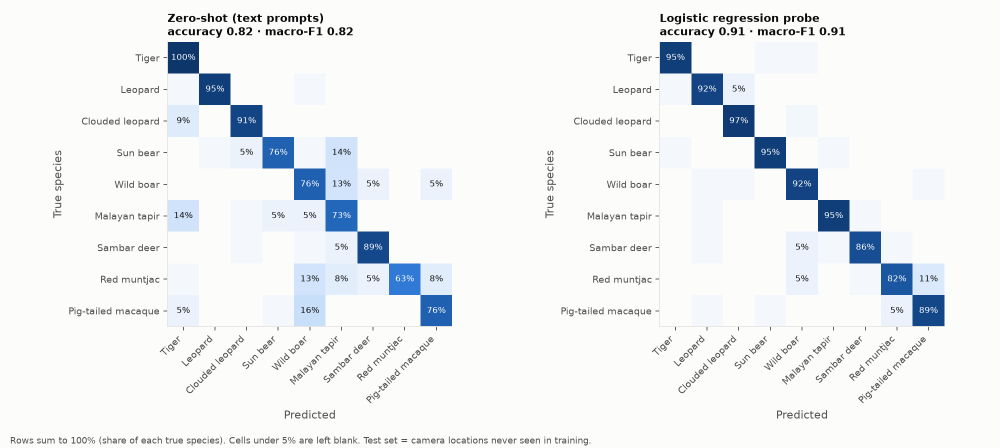
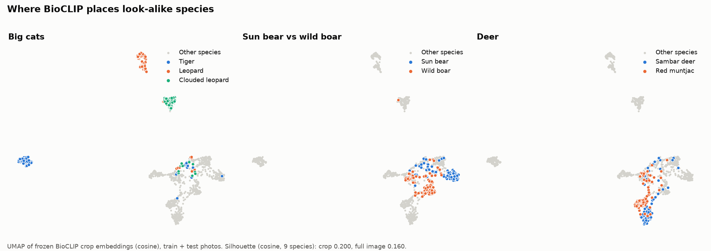

# Camera-trap triage + species classification

## What it does
`image → MegaDetector v5a → crop → BioCLIP embedding → species → sighting record`

1. **Triage** (`detect.py`). MegaDetector labels each frame animal, person, vehicle or empty. Empty frames are dropped, and person or vehicle frames become an intrusion signal.
2. **Crop** (`detect.py`). The top animal box is cropped as a padded square, so the classifier sees the animal rather than the scene.
3. **Embed** (`embed.py`). A frozen BioCLIP (ViT-B/16) produces L2-normalised image and text embeddings.
4. **Classify** (`classify.py`). The same frozen features feed three classifiers:
   - zero-shot (nearest taxonomic text prompt)
   - linear probe (logistic regression)
   - kNN
5. **Sighting** (`pipeline.py`). Each frame becomes a JSON record whose fields map to `wis:Sighting` in the ontology. This is the hand-off to the reasoning half.

## Concepts demonstrated
- **Transfer learning and representations:** a foundation model trained on the Tree of Life is reused with no fine-tuning.
- **Zero-shot vs supervised:** does a small labelled set (about 110 images per class) beat text prompts on the *same* features? A gain from the probe means the representation separates the classes, but the prompts point to the wrong places.
- **Honest evaluation:**
  - The train/test split is grouped by camera location (`dataset.py`), so no camera appears in both.
  - Only one frame per burst sequence is kept.
  - Reporting covers per-class precision/recall and look-alike confusion (tiger↔leopard↔clouded leopard, sun bear↔wild boar, sambar↔muntjac), not only accuracy.

## Data
LILA WCS Camera Traps: 9 classes, 133–150 images each (leopards from Kenya, Tanzania and Laos; the other classes from Indonesia and Laos). The split is grouped by location: 999 train images from 489 camera locations, 334 test images from 160 *different* locations. See [data/README.md](../../../data/README.md) for the caveats (Sumatran tigers, Kenyan leopards, no human images).

## Result

Run: `python -m src.perception.camera_trap.experiment` then `python -m src.perception.camera_trap.plots`.
All numbers come from [results/camera_trap/metrics.json](../../../results/camera_trap/metrics.json). The 95% intervals come from a bootstrap that resamples **camera locations**, not images: photos from one camera aren't independent, so an image-level bootstrap would give falsely narrow intervals.

| Classifier (same frozen BioCLIP features) | Accuracy | Macro-F1 | 95% CI (macro-F1) |
|---|---|---|---|
| Zero-shot, taxonomic prompts | 0.820 | 0.822 | 0.764–0.869 |
| Zero-shot, plain prompts ("a camera trap photo of a …") | 0.778 | 0.777 | 0.720–0.825 |
| Zero-shot, full image (no crop) | 0.778 | 0.778 | 0.711–0.832 |
| **Logistic-regression probe** (C=10, chosen by grouped CV) | **0.913** | **0.913** | 0.878–0.945 |
| Logistic-regression probe, full image | 0.871 | 0.871 | 0.829–0.907 |
| **kNN probe** (k=20, chosen by grouped CV) | **0.913** | **0.914** | 0.881–0.944 |

**What it shows:**
1. **A little labelled data beats zero-shot.** The probe adds +0.09 macro-F1 over zero-shot. In the paired location bootstrap, the gain falls between +0.05 and +0.14, and the probe was better in 100% of resamples.
2. **Five labelled photos per species are enough.** Logistic regression trained on 5 photos per species (macro-F1 0.862) already beats zero-shot (0.822); at 2 photos it does not (0.777). See 
3. **Zero-shot errors are not the look-alikes I expected.**
   - The pre-registered look-alike pairs were rarely confused: tiger↔leopard ≤3%, sun bear↔wild boar ≤3%, sambar↔muntjac ≤6%. The one exception is clouded leopard→tiger, at 9% for zero-shot and 0% for the probe.
   - Instead, zero-shot errors flow into a few **"attractor" classes**. Of 60 errors, 16 were predicted as wild boar, 15 as Malayan tapir and 12 as tiger. Five tapirs were called tigers.
   - The probe learns its decision boundaries from photos, which removes most of this bias. The weakest species is red muntjac (zero-shot 63% → probe 82% recall), confused with macaque and boar.

   
4. **Cropping and prompt wording both matter.**
   - Classifying the MegaDetector crop beats the full frame, for zero-shot (0.822 vs 0.778) and for the probe (0.913 vs 0.871).
   - Taxonomic prompts beat plain-English prompts (0.822 vs 0.777).
   - For both zero-shot comparisons, the paired 95% interval excludes zero.
5. **MegaDetector triage at threshold 0.2:**
   - It found an animal in 98.1% of 1,350 animal photos.
   - It correctly left 88% of 50 empty frames empty; 6 got a false "animal" box.
   - It raised zero false person or vehicle alarms.
6. **The pangolin is an open-set test.** Pangolin wasn't in the probe's training classes.
   - Zero-shot, given pangolin as a 10th label, named 9 of 17 pangolins correctly; 5 were called tapir.
   - The closed-set probe *cannot* say "new species". It forced 8 of the 17 into clouded leopard.
   - Adding the pangolin label caused no false pangolins on the 9-class test set.
7. **The leopard domain gap is small in embedding space.**
   - The location split left only 3 Lao leopards in the test set, so accuracy can't answer the question.
   - In the embedding, all 20 Lao leopards fall in the same cluster as the Kenyan ones (97/106).
   - So BioCLIP doesn't separate African from SE Asian leopards. With only 20 Lao images, this is evidence, not proof.
8. **The geometry is overlapping but linearly separable.**
   - The cosine silhouette is only 0.20 for crops (0.16 for full images), so the classes overlap in raw distance.
   - Even so, a linear boundary reaches 91%. A UMAP picture of overlap doesn't mean the classes can't be separated.

   

## Limitations
- The test set is 334 photos from 160 locations, so intervals are ±3–5 points. The differences above are larger than that; small per-species differences are not.
- kNN picked k=20, the edge of the search grid, so a larger k might do slightly better.
- The "tigers" are Sumatran (Indonesia). The model never sees a Malayan tiger, and the subspecies is invisible to it.
- There are no human photos, so person detection is untested here. The plan is to test it on COCO images.
- Only 4 test photos were MegaDetector misses, which is too few to measure how classification degrades when detection fails.

## Next
- Leopard domain test with a dedicated split: train on African leopards only, test on all 20 Lao leopards.
- Extend the kNN grid.
- Optional: BioCLIP 2 as a bigger-backbone comparison.
- Person detection on COCO.
