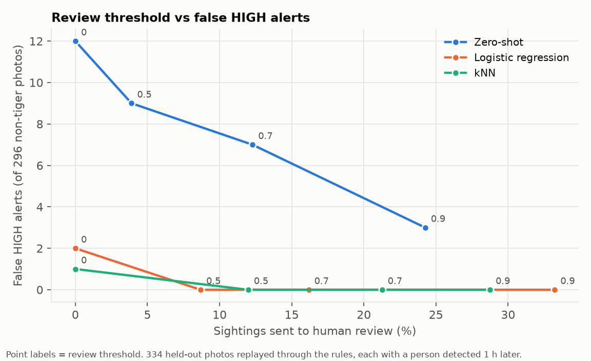

# Knowledge graphs and alert rules

Three KG types, each chosen for a different job:

| KG | Tech | Why this type | Status |
|---|---|---|---|
| **Ontology KG** | RDF/OWL, rdflib, SPARQL | Curated facts and rules need explicit semantics: classes, a defined class (`ThreatenedTaxon`), and status ranks that rules can compare. | Built: schema, seed, GBIF reconciliation, alert rules |
| **Property graph** | NetworkX | Occurrence data is large, messy and relational (who saw what, where, when). Graph analytics such as co-occurrence fit it better than OWL. | Built ([graph/](../graph/README.md)) |
| **Embedding KG** | PyKEEN (TransE vs another model) | Predicts *missing* species–habitat links that nobody curated. Extends my TransE/UMLS assignment. | In progress ([graph/](../graph/README.md)) |

## Files
- `ontology.ttl`: **TBox** (schema). Taxa, habitats, IUCN status (with ordinal `statusRank`), threats, zones, sightings, alerts, review tasks, and the rule-engine vocabulary.
- `species.csv`, `zones.csv` → `build_seed.py` → `species_seed.ttl`: the curated **ABox** (26 taxa, 9 protected areas).
- `reconcile.py` → `observations.ttl`: facts derived from GBIF records under two explicit rules (below).
- `sightings.py`: the **perception → reasoning adapter**. It turns a detection into a `wis:Sighting` node. The classifier's answer is stored as `predictedTaxon`; the rules decide what the KG believes.
- `rules.py`: the **alert rule engine** (SPARQL forward chaining).
- `replay.py`: replays real camera-trap test predictions through the rules.

## Concepts demonstrated
- **Knowledge representation:**
  - TBox vs ABox
  - OWL defined classes
  - the **open-world assumption**: a missing record is not evidence of absence
- **Rule-based reasoning:**
  - forward chaining to a **fixpoint**
  - **stratified negation**: rules that test for absence run only after what they test for is fully derived
  - **conflict resolution**: one alert per event
  - **explanations**: every alert carries its reasons
- **Knowledge filling gaps in perception:** the classifier only sees "tiger"; a rule infers the Malayan subspecies from location.
- **Knowledge checking perception:** sightings that are implausible for the zone's country or habitat go to human review.

## GBIF reconciliation (`reconcile.py`)
Two documented rules decide how the curated facts and the data are combined:
1. **Country presence** is asserted if the seed says present *or* there are ≥ 3 records since 2015. Zero records never deletes a seeded fact; it's only flagged.
2. **Zone links** are asserted if there are ≥ 2 records within the zone's radius (SG 3 km, MY 20 km) **whose coordinate uncertainty fits inside that radius**.

**Results** ([reconciliation.json](../../../results/kg/reconciliation.json)):
- **Data added 3 facts my seed missed or was unsure of:** sambar (92 records) and greater mouse-deer (38) in Singapore, and bearded pig in Peninsular Malaysia (4). Red muntjac in Singapore is kept but flagged *unconfirmed* (0 records).
- **Threatened species' locations are deliberately blurred.** Records with > 10 km uncertainty:

  | IUCN status | Share blurred |
  |---|---|
  | CR | 79% |
  | EN | 95% |
  | VU | 61% |
  | LC | 7% |

  The typical blur is about 31 km. This protects the animals from poachers, and it is exactly what an anti-poaching rule would need.
- **Precision guard:** 31 zone links were asserted and 25 were blocked by the guard. The only CR species linked to any zone is the straw-headed bulbul; there are no zone links for the pangolin or the tiger.
- **Zone-level threat data doesn't discriminate.** Every zone holds at least one VU/EN species in the records. So the "person in a zone with a threatened species" rule (A4) raises every person alert to at least MEDIUM, which tells a ranger nothing about which zone matters. Recent camera evidence is what separates the cases.

## Alert rules (`rules.py`)

| Stratum | Rule | What it does |
|---|---|---|
| 1 Inference | T1 | Classifier prediction → `ofTaxon` |
| | T2 | **Subspecies refinement:** if exactly one subspecies of the predicted species occurs in the zone's country, the sighting is also that subspecies. A tiger in Malaysia is a Malayan tiger (CR). |
| | T3 | Species-level zone records carry over to that subspecies |
| | T4 | Taxon with IUCN rank ≥ VU → `ThreatenedTaxon` (materialises the OWL defined class) |
| 2 Checks | C1 / C2 | Issue: species not recorded in the zone's country / no shared habitat |
| | C3 | Issue: confidence below the review threshold for a threatened taxon (the threshold is stored *in the KG*) |
| | C4 | Issue: confidence below the threshold **and** the runner-up species is threatened (added after the replay found a blind spot; switchable in the KG) |
| 3 Triage | V1 / V2 | No issues → `verified`; any issue → human `ReviewTask` |
| 4 Alerts | A1 **HIGH** | Person within 72 h of a verified CR camera sighting in the same zone |
| | A2 **HIGH** | Person in a zone with precise GBIF records of a CR taxon |
| | A3 **HIGH** | Vehicle at night (19:00–06:00) in a zone with an EN/CR taxon |
| | A4 MEDIUM | Person in a zone with a VU/EN taxon |
| | A5 MEDIUM | Verified CR sighting (notify researchers) |
| | A6 / A7 LOW | Any person / vehicle |
| 5 Conflicts | R1 | One alert per event: a higher priority wins; on a tie the earlier rule wins, and the losing alert's reasons are kept in the explanation |

Example output (real):
```
HIGH  A1  Person detected in Taman Negara National Park near a verified camera sighting of
          Malayan tiger (Critically Endangered) | Person detected in Taman Negara National Park,
          where Straw-headed bulbul (Critically Endangered) has been recorded
REVIEW    Tiger is not recorded in Singapore
```

**Tests:** 17 scenario tests in [tests/test_rules.py](../../../tests/test_rules.py) cover HIGH, MEDIUM and LOW cases, the time window, night vs day, review routing, plausibility checks, the configurable threshold, one-alert-per-event and fixpoint stability. They caught a real bug: a `FILTER` inside a SPARQL `UNION` branch can't see variables bound outside the branch. That silently disabled the camera-evidence part of rules A3 and A4 until the time variable was re-bound inside the branch.

## Error replay: how classifier mistakes become alert mistakes (`replay.py`)

**Setup:**
- Each of the 334 held-out camera-trap photos becomes a sighting in Taman Negara, with the classifier's species, its confidence and its runner-up species.
- A person is then detected an hour later, and the rules decide that alert's priority.
- That priority is compared with the one the true species would get.
- This uses camera evidence only, with no zone records.

38 photos are tigers, so 38 cases should be HIGH. Every configuration is run twice: before and after the blind-spot fix (rule C4). [alert_replay.json](../../../results/kg/alert_replay.json)

| Classifier | Review threshold | False HIGH | HIGH precision | HIGH recall | Sent to review (after fix) |
|---|---|---|---|---|---|
| Zero-shot | none | **12** | 0.76 | 1.00 | 0% |
| Zero-shot | 0.5 | 9 | 0.80 | 0.97 | 3.9% |
| Zero-shot | 0.9 | 3 | 0.92 | 0.95 | 24.3% |
| Logistic regression | none | 2 | 0.95 | 0.95 | 0% |
| Logistic regression | 0.5 | **0** | 1.00 | 0.95 | 8.7% |
| kNN | 0.5 | **0** | 1.00 | 0.95 | 12.0% |



**What it shows:**
1. **Perception errors become decision errors.** Zero-shot's "attractor" mistakes turn into false HIGH alerts. 5 of its 12 false HIGH alerts are tapirs it called tigers.
2. **A confidence threshold can only catch *uncertain* mistakes, and zero-shot is confidently wrong.**
   - 22% of zero-shot's errors come with ≥ 0.9 confidence, against 3% for logistic regression.
   - Even at a 0.9 threshold (a quarter of sightings reviewed), zero-shot still raises 3 false HIGH alerts.
   - Caveat: zero-shot confidence depends on the softmax temperature (100), which I chose and did not calibrate.
3. **A blind spot in my own design, found and fixed.**
   - In the first version, review only triggered when the **predicted** species was threatened (rule C3). Logistic regression missed 2 tigers, both at 0.34 confidence. The one predicted as *sun bear* (VU) went to review; the one predicted as *wild boar* (LC) passed silently.
   - Rule C4 adds: *low confidence **and** the runner-up species is threatened → review*. Before vs after, at threshold 0.5:

   | | LR before | LR after | kNN before | kNN after |
   |---|---|---|---|---|
   | Tigers missed silently | 1 | **0** | 1 | **0** |
   | Silent priority errors (wrong and not reviewed) | 12 | **7** | 11 | **5** |
   | Species errors caught by review | 38% | **55%** | 41% | **69%** |
   | Sightings sent to review (cost) | 6.3% | 8.7% | 7.8% | 12.0% |
   | False HIGH alerts | 0 | 0 | 0 | 0 |

   - For zero-shot at 0.5 the fix changes almost nothing (34 silent errors either way). Its mistakes are confident, so they never reach the low-confidence condition.
   - Scenario tests s16 and s17 pin down the fix in both directions: it closes the gap with C4 on, and the gap reappears with C4 off.
4. **Review has a cost.** A reviewed sighting can't escalate until a human confirms it. The two remaining "missed" tigers are both in the review queue rather than lost, but they are delayed. "Priority correct" therefore falls as the threshold rises (logistic regression: 0.95 with no review, 0.91 at 0.5, 0.75 at 0.9).

## Next
- Calibrate zero-shot confidence (e.g. temperature scaling on the training split) so its review threshold means something.
- Property graph (co-occurrence) and PyKEEN link prediction on held-out `livesIn` triples.
