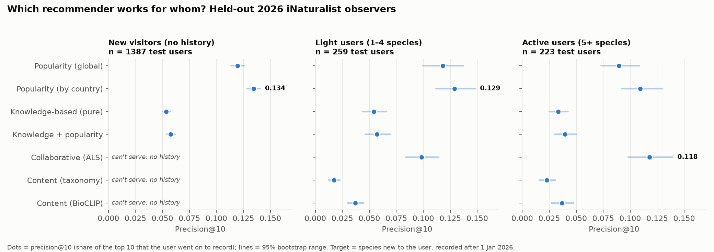
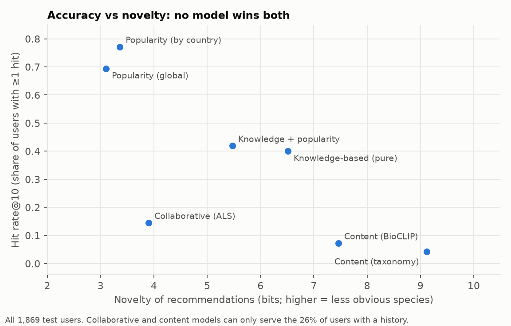

# Recommenders

The question: **when does knowledge beat learning, and the other way round?** Each architecture targets a scenario. All of them are scored by the same code, on the same held-out users.

| Scenario | Architecture | Why |
|---|---|---|
| New visitor, no history | **Knowledge-based** on the ontology KG: (a) pure knowledge, (b) KG filter + regional popularity | Cold start: nothing to learn from, but plenty we know |
| Active observer | **Collaborative filtering** (implicit ALS, observer × species) | Learns from who recorded what |
| "Species like the ones I've seen" | **Content-based**: (a) taxonomy + range, (b) **BioCLIP text embeddings** of species names | Works for rare species with few interactions |
| Production | **Switching hybrid**: one model per user segment | Policy chosen on *validation*, never on test |
| Baselines | Popularity (global, by country) | What every model must beat |

## Files
- `data.py`: interactions, time-based split, segments, novelty
- `base.py`: `Recommender` interface, `Rec` (item, score, **reasons**), popularity baseline
- `knowledge_based.py`: ontology recommender
  - **Hard constraints:** country, zone habitat, IUCN floor
  - **Soft preferences:** habitat interests, habitat breadth, threatened species
  - **Explanations:** every recommendation lists its reasons
  - **Trail suggestions:** `recommend_zones()`
- `collaborative.py` (ALS), `content_based.py`, `hybrid.py` (regional popularity, KG adapters, switching hybrid)
- `experiment.py` → `results/recsys/metrics.json`, `per_user_test.csv`; `plots.py` → figures

## Protocol
- **Data:** iNaturalist research-grade mammal and bird records (SG + Peninsular Malaysia): 63,003 records, 728 species.
- **Time-based split:**
  - **Validation:** train before 2025-07-01, evaluate July–December 2025. This is used to tune ALS (48 settings) and to choose the hybrid's policy.
  - **Test:** train before 2026-01-01, evaluate on 2026 records. Each model is refitted once and evaluated once.
- **Target:** species a user recorded after the cutoff that were **new to them**.
- **Test users:** 1,869 in total.

  | Segment | History | Test users |
  |---|---|---|
  | **Cold** | none | 1,387 (74%) |
  | **Light** | 1–4 species | 259 |
  | **Heavy** | 5+ species | 223 |

- **Metrics:** precision@10 with a 95% bootstrap range over users, recall@10, hit rate@10, the share of users a model can serve at all, catalogue coverage, and novelty (mean self-information of the recommended species, in bits).

## Result (test, precision@10, 95% range)

| Model | Cold (1,387) | Light (259) | Heavy (223) | Hit rate (all) | Novelty | Serves |
|---|---|---|---|---|---|---|
| Popularity (global) | 0.119 | 0.118 | 0.090 | 0.69 | 3.1 | 100% |
| **Popularity (by country)** | **0.134** (0.129–0.141) | **0.129** (0.112–0.148) | 0.109 (0.092–0.130) | **0.77** | 3.4 | 100% |
| Knowledge-based (pure) | 0.054 | 0.054 | 0.033 | 0.40 | 6.5 | 100% |
| Knowledge + popularity | 0.058 | 0.057 | 0.040 | 0.42 | 5.5 | 100% |
| Collaborative (ALS) | can't serve | 0.099 | **0.118** (0.098–0.140) | 0.15 | 3.9 | 26% |
| Content (taxonomy) | can't serve | 0.017 | 0.023 | 0.04 | **9.1** | 26% |
| Content (BioCLIP) | can't serve | 0.037 | 0.037 | 0.07 | 7.5 | 26% |
| **Switching hybrid** (policy from validation) | = popularity (by country) in every segment | | | 0.77 | 3.4 | 100% |

**What it shows:**
1. **The simplest baseline won.** "Show the most-observed species in your country" beats every other model for new and light users, and ties ALS for active users. On validation it won every segment, so the switching hybrid, correctly chosen without looking at the test set, became popularity everywhere.

   **A switching hybrid only helps if there is a crossover, and in this data there isn't one.**
2. **Active users are a tie, not a win for ALS.** ALS − popularity for heavy users is +0.009 (paired 95% range −0.005 to +0.023), and on validation the order was reversed. The best ALS setting was the most heavily regularised one tested (regularisation 100; every factor count scored about the same). That's the edge of the search grid, and at that setting ALS behaves much like popularity. At 0.73% matrix density, the collaborative signal beyond "what's common" is weak.
3. **Cold start dominates.** 74% of test users are new. Collaborative and content models can serve only the 26% with a history.
4. **Curated knowledge is explainable but narrow.**
   - The knowledge-based recommender reaches about 0.055 precision. It can only recommend the 23 KG species present in the data, which make up 14% of test targets, and that sets its ceiling.
   - Regional popularity beats it on new users by +0.077 (paired range +0.072 to +0.082).
   - Ordering the KG's eligible species by popularity adds only +0.004, so the eligibility filter is the binding constraint, not the ranking.
   - It does give every recommendation a reason ("recorded in SG; lives in 4 habitat types; IUCN EN"), recommends less obvious species (5.5–6.5 bits vs 3.4), and is the only non-popularity model that can serve new visitors.
5. **The representation from the perception half helped.** As content features, BioCLIP's text embeddings of species names beat hand-built taxonomy features: +0.017 precision for light and heavy users (paired range +0.011 to +0.024).
6. **Accuracy vs novelty.** No model wins both. Popularity is accurate but obvious; content-based is novel (7.5–9.1 bits) but rarely right; knowledge-based sits in between.

## Limitations
- The paired comparisons were run on the test set *after* model selection was fixed. They describe the result and were not used to choose anything.
- ALS's best setting is at the edge of the regularisation grid.
- The observer data is a year-stratified sample (all mammals; 20k birds per region), not complete.
- "Recorded next" is a proxy for "would enjoy seeing". It rewards common species, which favours popularity by design.
- Trail suggestions (`recommend_zones`) are built but not evaluated: there's no ground truth for which zone a person visited, and threatened-species coordinates are blurred (see the KG README).

## Next
- A **weighted** hybrid instead of a switching one: blend ALS or BioCLIP-content scores with popularity, with the weight tuned on validation.
- A diversity-aware evaluation, since popularity's accuracy partly comes from recommending the same 10 species to everyone (coverage 14%).
